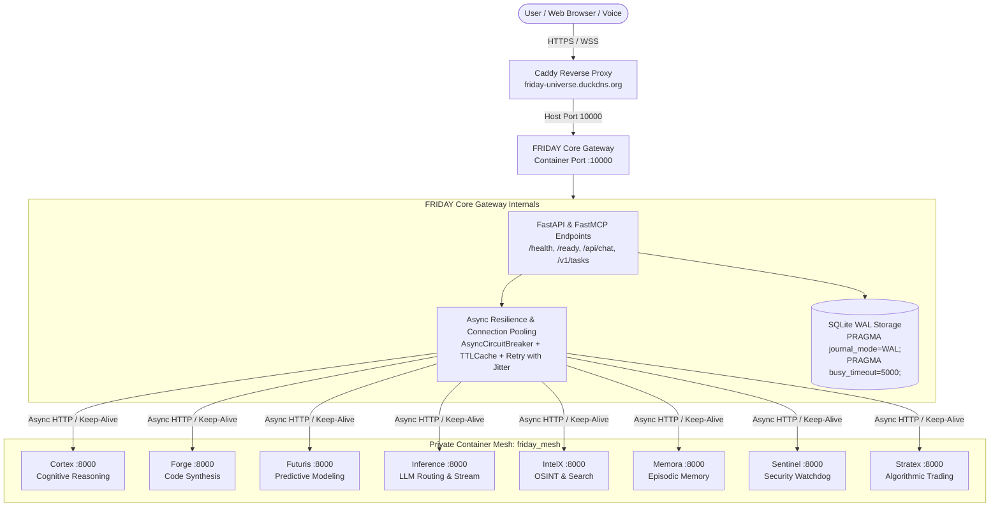

# FRIDAY Core — Cognitive Orchestrator & Master API Gateway

[](https://github.com/surendra2304/FRIDAY/actions/workflows/ci.yml)
[](https://www.python.org/downloads/)
[](https://www.docker.com/)
[](LICENSE)

> **F**ully **R**esponsive **I**ntelligent **D**igital **A**ssistant for **Y**ou  
> Central Brain, Cognitive Orchestrator, and Master API Gateway of the FRIDAY Universe.

---

## 🏛️ System Overview

**FRIDAY Core** serves as the primary cognitive gateway, voice/vision perception engine, multi-agent orchestrator, and master API dispatcher for the entire FRIDAY Universe.

### Infrastructure & Deployment Target
- **Host Target**: Oracle Cloud Always Free (2 OCPUs, 12 GB RAM Ampere A1 ARM64 / AMD x86_64).
- **Public Domain**: `https://friday-universe.duckdns.org`
- **Reverse Proxy**: Caddy with automated HTTPS certificate generation and path routing.
- **Internal Network**: Docker bridge mesh network (`friday_mesh`).
- **Gateway Identity**: `friday_core` listening on **Container Port 10000** (Host Port `10000`).
- **Public Routes**:
  - `https://friday-universe.duckdns.org/` ➔ FRIDAY Core HUD & API Gateway
  - `https://friday-universe.duckdns.org/friday/*` ➔ FRIDAY Core API & WebSocket streams

### Key Capabilities
1. **Unified Multi-Provider AI Gateway**: Real-time cross-provider failover (`Groq` ➔ `Mistral` ➔ `OpenRouter` ➔ `AI Universe`) for sub-second text reasoning and tool calling.
2. **Dedicated Voice & Multimodal Perception**: Dedicated Google Gemini Live API integration for full-duplex conversational voice, server-side Voice Activity Detection (VAD), and screen OCR.
3. **Specialist Multi-Agent Delegation**: Orchestrates tasks across 8 specialized containerized peer agents via the internal `friday_mesh` network.
4. **FastMCP Server**: Standardized Model Context Protocol server exposing system tools, terminal execution, and device control.
5. **Universal Computer Control**: Native Win32 UI automation, application lifecycle management, and Android ADB device abstraction.
6. **Standing-Mandate Autonomy**: Signed, cryptographic self-repair and diagnostic loops capable of fixing codebase errors in sandboxes before deployment.

### Core Architecture & Mesh Flow


---

## 🌐 Universe Mesh Topology

All 8 specialist peer agents run internally on **Container Port 8000** across the private `friday_mesh` Docker network. Public access is reverse-proxied securely through Caddy.

| Agent / Service | Internal Mesh URL | Host Port | Public Gateway URL | Primary Responsibility |
| :--- | :--- | :---: | :--- | :--- |
| **FRIDAY Core** | `http://friday:10000` | `10000` | `https://friday-universe.duckdns.org/` | Master Cognitive Gateway, Voice/Vision Brain & HUD |
| **CORTEX** | `http://cortex:8000` | `8001` | `https://friday-universe.duckdns.org/cortex/*` | High-order cognitive reasoning & multi-agent debate |
| **FORGE** | `http://forge:8000` | `8002` | `https://friday-universe.duckdns.org/forge/*` | Autonomous code synthesis, testing & sandbox execution |
| **FUTURIS** | `http://futuris:8000` | `8003` | `https://friday-universe.duckdns.org/futuris/*` | Predictive modeling, trend forecasting & scenario analysis |
| **INFERENCE** | `http://inference:8000` | `8004` | `https://friday-universe.duckdns.org/inference/*` | Low-latency LLM routing, token caching & streaming gateway |
| **INTELX** | `http://intelx:8000` | `8005` | `https://friday-universe.duckdns.org/intelx/*` | Real-time web intelligence, OSINT & deep search |
| **MEMORA** | `http://memora:8000` | `8006` | `https://friday-universe.duckdns.org/memora/*` | Universal episodic memory, semantic recall & vector storage |
| **SENTINEL** | `http://sentinel:8000` | `8007` | `https://friday-universe.duckdns.org/sentinel/*` | Cryptographic watchdog, audit verification & security scanner |
| **STRATEX** | `http://stratex:8000` | `8008` | `https://friday-universe.duckdns.org/stratex/*` | 24/7 Algorithmic trading execution (Gunicorn WSGI / Binance Futures) |

---

## 🚀 API Endpoints

FRIDAY Core exposes a comprehensive REST and WebSocket interface:

### Core, Health & Readiness
- `GET /` & `GET /ui`: Serves the WebGL Holographic Command Center HUD.
- `GET /health` & `GET /api/health`: Liveness probe returning process health and peer connectivity:
  ```json
  {
    "status": "healthy",
    "service": "friday_core",
    "version": "2.0.0",
    "overall": "healthy",
    "evidence_class": "process_liveness",
    "observed_at": "2026-10-14T16:00:00.000000+00:00",
    "peers_mesh": "connected",
    "checks": [...]
  }
  ```
- `GET /ready` & `GET /api/ready`: Readiness probe verifying local SQLite integrity and pre-flight configuration:
  ```json
  {
    "status": "ready",
    "ready": true,
    "service": "friday_core",
    "version": "2.0.0",
    "timestamp": "2026-10-14T16:00:00.000000+00:00",
    "database": "healthy",
    "mesh": "configured"
  }
  ```

### Standardized Error Envelope
All error responses strictly follow the unified envelope:
```json
{
  "error": "HTTP_404",
  "message": "Not Found",
  "success": false
}
```

### Chat & LLM
- `POST /api/chat`: Multi-turn conversational interface with multi-provider failover.
- `POST /v1/chat/completions`: OpenAI-compatible streaming completion endpoint.

### Voice & Perception
- `POST /api/voice`: Audio synthesis and voice command processing.
- `GET /api/voice/ws`: Bidirectional full-duplex Gemini Live audio WebSocket.

### Task Management
- `GET /v1/tasks/{id}` / `GET /api/tasks/{id}`: Inspect task lifecycle state.
- `GET /v1/tasks/{id}/events` / `GET /api/tasks/{id}/events`: Server-Sent Events (SSE) stream for real-time task progress.
- `POST /v1/tasks/{id}/cancel`: Graceful cancellation of in-flight tasks.
- `POST /v1/tasks/cancel-all`: Emergency cancellation of all executing tasks.

### Observability & Telemetry
- `GET /api/agents/supervision`: Real-time reachability and health status of all 8 peer agents.
- `GET /api/telemetry`: Hardware vitals (CPU %, RAM %, Battery).
- `GET /api/system_telemetry`: Detailed system hardware metrics for HUD cards.
- `GET /api/metrics`: Internal observability counters and latency metrics.

### FastMCP
- `GET /sse`: Server-Sent Events channel for FastMCP tool discovery.
- `POST /messages`: FastMCP tool execution and JSON-RPC dispatch.

---

## ⚙️ Environment Variables

Configure FRIDAY Core by creating a `.env` file (copied from `.env.example`):

| Variable | Default | Purpose / Scope |
| :--- | :--- | :--- |
| **Server & Networking** | | |
| `PORT` | `10000` | Server listening port |
| `HOST` | `0.0.0.0` | Server binding address |
| `FRIDAY_ENV` | `production` | Deployment mode (`development`, `production`, `testing`) |
| `FRIDAY_ALLOWED_ORIGINS` | `http://localhost:3000,http://127.0.0.1:3000` | CORS whitelist (domain `https://friday-universe.duckdns.org` automatically whitelisted) |
| `FRIDAY_REQUIRE_API_KEY_ON_LOOPBACK` | `false` | Require API key for local loopback control |
| `FRIDAY_API_KEY` | *(empty)* | Master authorization key for external control access |
| **LLM & Reasoning** | | |
| `FRIDAY_LLM_PROVIDER` | `chain` | Reasoning provider (`chain`, `groq`, `mistral`, `openrouter`, `gemini`, `mock`) |
| `FRIDAY_LLM_MODEL` | `gemini-3.6-flash` | Primary reasoning model name |
| `FRIDAY_GROQ_API_KEY` | *(empty)* | Primary sub-second inference API key |
| `FRIDAY_MISTRAL_API_KEY` | *(empty)* | Failover tier-1 inference API key |
| `FRIDAY_OPENROUTER_API_KEY` | *(empty)* | Failover tier-2 inference API key |
| `FRIDAY_GEMINI_API_KEY` | *(empty)* | Dedicated voice, screen vision, and embeddings API key |
| `FRIDAY_GEMINI_FALLBACK_API_KEY_1..4` | *(empty)* | Rotating pool of Gemini fallback keys |
| **Inter-Agent Mesh URLs** | | |
| `CORTEX_URL` | `http://cortex:8000` | Cognitive reasoning specialist URL |
| `FORGE_URL` | `http://forge:8000` | Software engineering & execution sandbox URL |
| `FUTURIS_URL` | `http://futuris:8000` | Predictive forecasting specialist URL |
| `INFERENCE_URL` | `http://inference:8000` | LLM streaming gateway URL |
| `INTELX_URL` | `http://intelx:8000` | Real-time search & OSINT specialist URL |
| `MEMORA_URL` | `http://memora:8000` | Vector memory & recall specialist URL |
| `SENTINEL_URL` | `http://sentinel:8000` | Security watchdog specialist URL |
| `VYRALX_URL` | `http://vyralx:8000` | Video production and approval-governed YouTube distribution agent URL |
| `STRATEX_URL` | `http://stratex:8000` | 24/7 Algorithmic trading bot URL |

FRIDAY uses VyralX's documented authenticated `POST /api/v1/tasks` contract for explicit structured tasks. HTTP 202 is recorded as pending, not completed; a separate status query reads the queue and never creates or publishes content. Publishing remains approval-governed within VyralX and is not exposed as a direct FRIDAY upload action.
| **Autonomy & Self-Repair** | | |
| `FRIDAY_AUTONOMY_KEY` | *(empty)* | Secret HMAC key authorizing autonomous standing mandates |
| `FRIDAY_AUTONOMY_LEDGER` | `data/autonomy_mandates.json` | Path to persistent mandate ledger |
| `FRIDAY_REFLEX_ENABLED` | `true` | Enable background self-repair reflex loop |
| `FRIDAY_REFLEX_INTERVAL_SECONDS` | `900` | Interval between autonomous health/reflex scans |
| `FRIDAY_OWNER_NAME` | *(empty)* | Name of the authorized owner (e.g. `Surendra`) |
| **Devices & Hardware** | | |
| `FRIDAY_ACTIVE_DEVICE` | `windows` | Active device automation driver (`windows`, `android`, `mock`) |
| `FRIDAY_FACE_AUTH_ENABLED` | `false` | Enable MediaPipe facial biometric verification |
| `FRIDAY_DESKTOP_ENABLED` | `true` | Enable desktop companion integration |
| `FRIDAY_DESKTOP_HOTKEY` | `Ctrl+Shift+Space` | Global activation hotkey |

---

## 🏃 Running FRIDAY Core

### 1. Local Standalone (Development)

Ensure Python 3.11+ is installed.

```powershell
# 1. Clone repository
git clone https://github.com/surendra2304/FRIDAY.git
cd FRIDAY

# 2. Create and activate virtual environment
python -m venv .venv
.venv\Scripts\activate

# 3. Install dependencies
pip install --upgrade pip
pip install -r requirements.txt

# 4. Configure environment
copy .env.example .env
# Edit .env with your API keys

# 5. Start FRIDAY Core server
python -m uvicorn friday.api.server:app --host 0.0.0.0 --port 10000
```

### 2. Docker Container (Production)

FRIDAY Core includes a hardened, multi-stage, non-root `Dockerfile` optimized for Oracle Cloud Always Free:

```bash
# Build the production image
docker build -t friday_core .

# Run standalone container
docker run -d \
  --name friday_core \
  --restart unless-stopped \
  -p 10000:10000 \
  --env-file .env \
  friday_core
```

### 3. Unified Docker Compose Mesh (`friday_mesh`)

When deploying on the Oracle Cloud host alongside the other 8 specialist peer agents:

```yaml
version: "3.8"

networks:
  friday_mesh:
    name: friday_mesh
    driver: bridge

services:
  caddy:
    image: caddy:2-alpine
    restart: always
    ports:
      - "80:80"
      - "443:443"
    volumes:
      - ./Caddyfile:/etc/caddy/Caddyfile:ro
      - caddy_data:/data
      - caddy_config:/config
    networks:
      - friday_mesh

  friday_core:
    build:
      context: ./FRIDAY
      dockerfile: Dockerfile
    container_name: friday_core
    restart: unless-stopped
    ports:
      - "10000:10000"
    env_file: ./FRIDAY/.env
    networks:
      - friday_mesh
    depends_on:
      - cortex
      - forge
      - futuris
      - inference
      - intelx
      - memora
      - sentinel
      - stratex

  # Specialist peer agents run on internal container port 8000
  cortex:
    image: friday/cortex:latest
    container_name: cortex
    networks:
      - friday_mesh

  forge:
    image: friday/forge:latest
    container_name: forge
    networks:
      - friday_mesh

  futuris:
    image: friday/futuris:latest
    container_name: futuris
    networks:
      - friday_mesh

  inference:
    image: friday/inference:latest
    container_name: inference
    networks:
      - friday_mesh

  intelx:
    image: friday/intelx:latest
    container_name: intelx
    networks:
      - friday_mesh

  memora:
    image: friday/memora:latest
    container_name: memora
    networks:
      - friday_mesh

  sentinel:
    image: friday/sentinel:latest
    container_name: sentinel
    networks:
      - friday_mesh

  stratex:
    image: friday/stratex:latest
    container_name: stratex
    networks:
      - friday_mesh

volumes:
  caddy_data:
  caddy_config:
```

---

## 🧪 Testing & Verification

Run the test suite to verify container and mesh compatibility:

```bash
# Run container compatibility and health check tests
python -m pytest tests/test_container_compatibility.py

# Run non-live, portable test suite
python -m pytest -m "not live and not hardware and not windows"
```

---

## 🔒 Security & Safe Execution
- **Non-Root Execution**: Runs under UID `1000` (`appuser`) in all Docker environments.
- **Zero Raw Secrets**: API keys, credentials, and tokens are scrubbed from trace logs and exception payloads.
- **Origin Gate Enforcement**: Cross-origin state changes are guarded by strict CORS and authorization middleware.
- **Circuit Breakers**: Multi-agent network calls use timeout-guarded async HTTP sessions preventing cascading failures.
